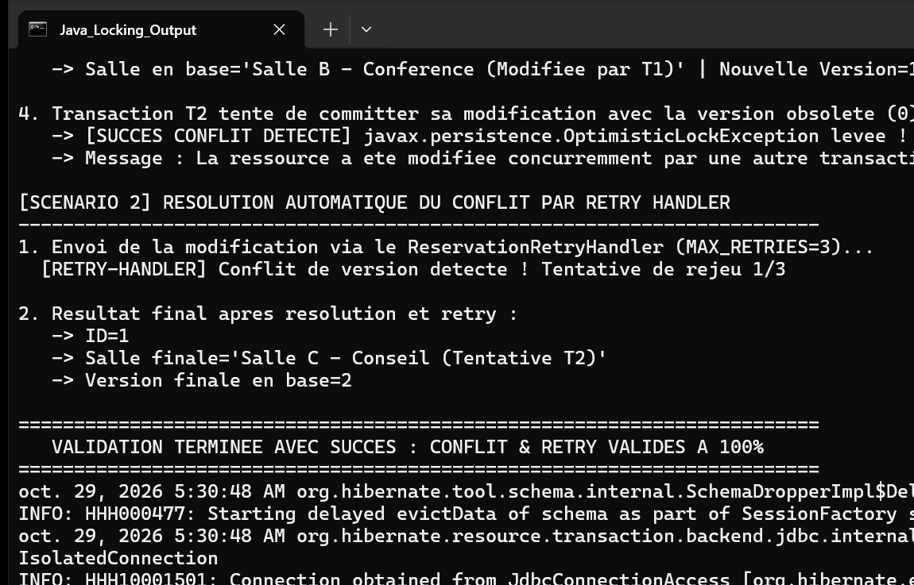

# TP 6 : Verrouillage Optimiste JPA avec @Version et Gestion de Conflits

Ce projet démontre l'implémentation et le fonctionnement du mécanisme de verrouillage optimiste (Optimistic Locking) en JPA avec Hibernate, la simulation d'un conflit de concurrence entre deux transactions, et sa résolution automatisée à l'aide d'un gestionnaire de réessais (Retry Pattern).

## Principes et Architecture

### 1. Entité avec `@Version`
- **Classe :** `com.example.model.Reservation`
- **Champ :** `private int version` annoté `@Version`.
- **Mécanisme :** À chaque mise à jour réussie en base de données, Hibernate incrémente automatiquement la valeur du champ version. Si une transaction tente de persister une modification alors que la version en base a déjà été augmentée par une transaction concurrente, Hibernate détecte l'écart (`0 ligne affectée lors du UPDATE`) et lève une exception `javax.persistence.OptimisticLockException`.

### 2. Simulation de Conflit Concurrent
- **Scénario 1 :**
  1. Création d'une réservation initiale (version 0).
  2. Deux transactions indépendantes T1 et T2 chargent l'entité simultanément (toutes deux détiennent la version 0).
  3. La transaction T1 modifie la désignation de la salle et valide son commit : la version en base passe à 1.
  4. La transaction T2 tente ensuite de committer sa propre modification en utilisant son instance obsolète (version 0).
  5. Déclenchement et interception de l'exception `OptimisticLockException`.

### 3. Stratégie de Résolution Automatique (Retry Pattern)
- **Composant :** `com.example.retry.ReservationRetryHandler`
- **Scénario 2 :**
  - En cas d'interception de l'`OptimisticLockException`, le gestionnaire recharge immédiatement une instance fraîche de l'entité depuis la base de données (contenant la dernière valeur de version).
  - Il réapplique les modifications souhaitées sur cette instance actualisée et réexécute la transaction.
  - La transaction aboutit avec succès et la version finale est incrémentée à 2.

## Exécution et Tests

### Commandes Maven
Exécution de la suite de tests unitaires JUnit :
```bash
mvn clean test
```

Lancement de la démonstration console :
```bash
mvn clean compile exec:java -Dexec.mainClass="com.example.App"
```

## Résultat d'Exécution

La capture ci-dessous illustre l'exécution de la classe principale `com.example.App`.



### Description de la Capture
- L'en-tête confirme le démarrage de l'application et l'initialisation de l'unité de persistance `reservationPU`.
- Scénario 1 : Création de la réservation initiale, validation concurrente par T1 faisant passer la version de 0 à 1, puis échec du commit de T2 avec levée et interception de `javax.persistence.OptimisticLockException`.
- Scénario 2 : Prise en charge du conflit par le `ReservationRetryHandler`, rechargement de la version courante en base et réapplication avec succès, aboutissant à la version finale 2 sans altération de l'intégrité des données.
- Clôture normale de l'application.
